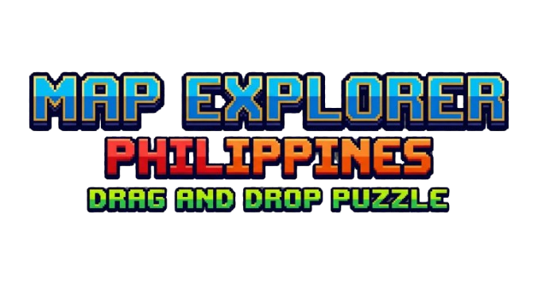

# Map Explorer PH

A drag-and-drop Philippine geography learning game built with Flutter and Dart.

Players explore Luzon, Visayas, and Mindanao by placing region puzzle pieces, learning regional facts, and answering quizzes to unlock the next island group.



## Features

- **Map puzzles:** drag region pieces onto their matching positions in the included island maps.
- **Regional facts and review:** learn facts about the regions represented in each stage and review them before a quiz.
- **Quizzes and progression:** answer multiple-choice questions, earn completion rewards, and unlock later stages by passing quizzes.
- **Character selection:** choose a character and enter a player name for the learning journey.
- **Local progress:** save stage unlocks and completion using SharedPreferences, with a reset option in Settings.
- **Audio and narration:** background music, sound effects, volume controls, and Filipino text-to-speech introductions on supported devices.
- **Animated presentation:** pixel-style artwork, moving clouds and waves, character animations, and confetti feedback.

The game uses its included regional datasets and artwork; it is not a live navigation or GPS application.

## Technology

| Area | Tools |
| --- | --- |
| Application | Flutter and Dart |
| Local storage | shared_preferences |
| Typography | google_fonts |
| Music and sound effects | audioplayers |
| Spoken introductions | flutter_tts |
| Celebration effects | confetti |

## Project structure

```text
lib/main.dart                    App entry point and landing page
lib/character_selection_screen.dart
lib/island_selection_screen.dart Character and stage selection
lib/*intro*.dart                 Stage introductions and narrated guidance
lib/game_map_*.dart              Drag-and-drop puzzle stages
lib/*quiz_screen.dart            Regional quizzes and stage completion
lib/region_data*.dart            Region definitions, facts, and puzzle placement
lib/audio_manager.dart           Background music and sound effects
lib/settings_screen.dart         Audio settings and progress reset
assets/images/                   Maps, characters, badges, and backgrounds
assets/audio/                    Game music and sound effects
test/                            Existing Flutter widget test
android/, ios/, web/             Platform projects
windows/, macos/, linux/         Desktop platform projects
```

## Run locally

Use Flutter with Dart 3.9.2 or a compatible later Dart 3 release. The committed lockfile currently requires Flutter 3.35.0 or later.

```sh
flutter pub get
flutter devices
flutter run
```

Select an available emulator or connected device. To target a specific device, use `flutter run -d DEVICE_ID` with an ID reported by `flutter devices`.

The gameplay data, artwork, and sound effects are included in this repository. No application backend or API key is configured in the current source. Google Fonts may download fonts at runtime, and speech support depends on the device's installed text-to-speech engine and Filipino voice availability.

Platform folders are included, but their presence does not establish that every platform has been tested. Android development requires the Android SDK and a compatible Java installation. Apple-platform builds require the corresponding Apple tooling.

## Development checks

```sh
flutter analyze
flutter test
```

The existing `test/widget_test.dart` still contains starter counter-app assertions and needs to be updated for this game's screens; it is not a passing gameplay regression suite. Manual verification should cover piece placement, quiz scoring, stage unlocks, saved progress, narration, and audio behavior.

The Android project retains its starter application ID and debug signing for release-mode builds. Configure your own application ID and release signing before distributing a production release.

## Repository contents

This repository includes the game source, bundled assets, platform projects, `pubspec.yaml`, and `pubspec.lock`. Build output, Dart/Flutter caches, local SDK paths, environment files, and signing credentials are excluded through the project and platform `.gitignore` files.

The project demonstrates drag-and-drop interaction, animated Flutter screens, quiz generation from regional facts, local state persistence, and audio integration. This README describes the checked-in implementation without claiming complete geography coverage or verification on every platform.
